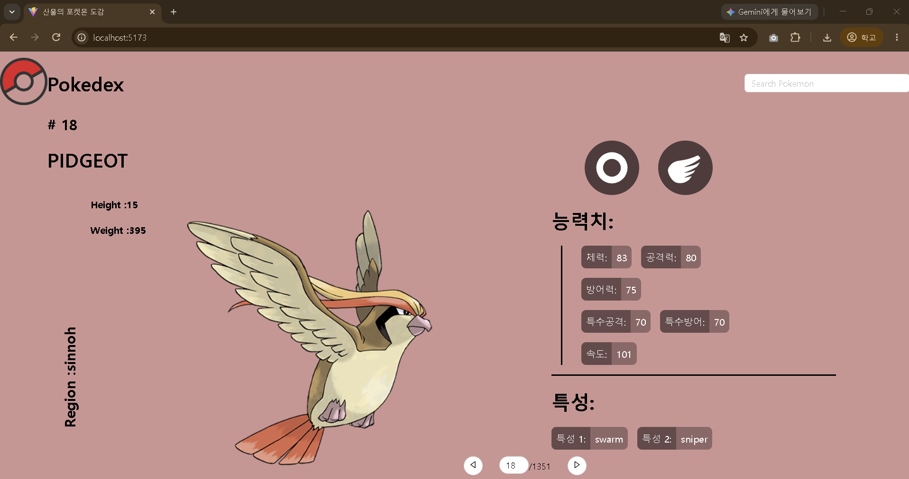
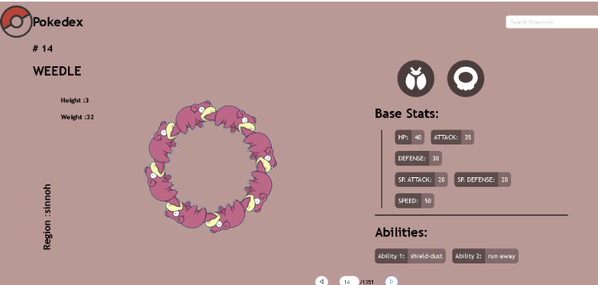
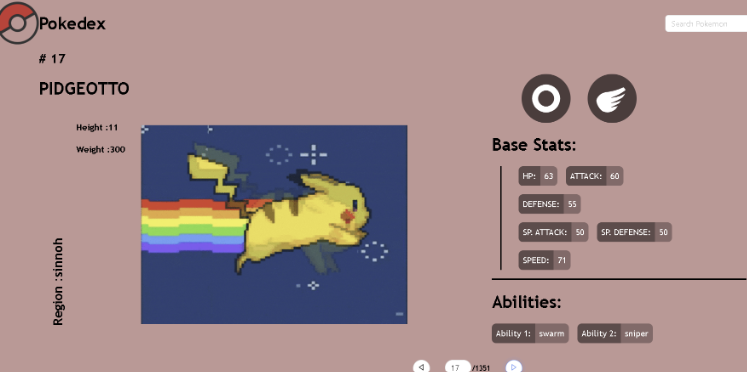
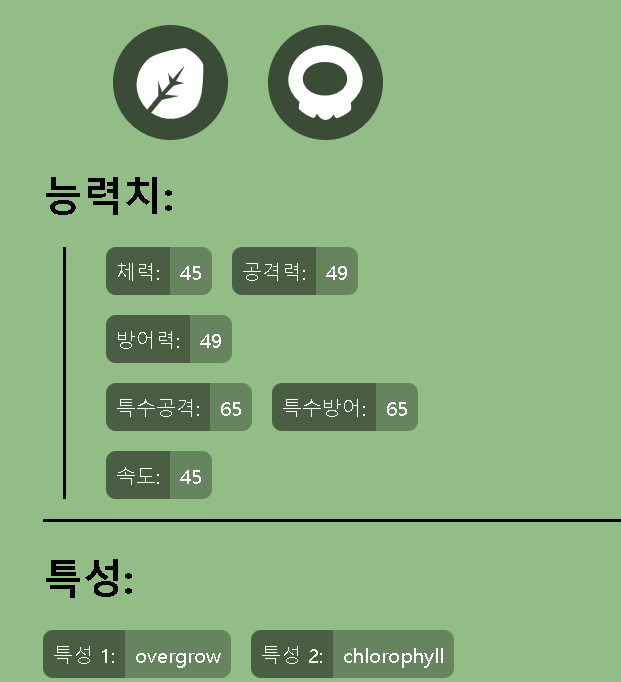

#산울의 포켓몬 도감 프로젝트
PokeAPI를 사용해서 만든 포켓몬 도감 웹앱을 선택하였다. 과제 주제에 적합하고 포켓몬을 좋아해서 이 주제를 선정하게 되었다.
원본 gitHub: https://github.com/Ryalcantara/react-pokedex-vite.git

배포 vercel URL: react-pokedex-vite-egdiehh1g-sanwxxl.vercel.app


설치 방법: npm install, npm run dev 로 실행하였다.

실행화면:

  

#주요 기능 설명

주요 파일
---
   > components/Root.jsx:
      앱의 두뇌 역할이다. useState는 포켓몬의 번호와 키 몸무게 등 정보를 저장하고,  useEffect로 id가 바뀔때마다 PokeAPI를 불러서 그 state를 채운다.
   
   > components/TopBar.jsx
      검색 기능을 담당한다. 처음 페이지가 열릴 때 전체 포켓몬 이름 목록을 받아와서 입력창에서 그 글자를 치면 filter로 그 글자로 시작하는 이름만 검색해준다.


주요 컴포넌트 
---
   >Footer:
      화면 아래에 화살표 두개와 포켓몬 번호(id)를 표시하는 영역이다 ( <| 번호 |>).
      <를 누르면 prevCount, >를 누르면 forwardCount, 숫자를 입력하면 paging을 부른다. 즉 Footer는 직접 번호를 바꾸지 않고 "번호 바꿔줘"라고 Root에게 요청만 보내고, 그러면 Root의 id가 바뀌고 모든 컴포넌트가 새 포켓몬으로 다시 그려진다.


코드 설명
---


코드:
```jsx
 const [sprite, setSprite] = useState(loading);
   useEffect(() => {
  setSprite(loading);
  fetch(`https://pokeapi.co/api/v2/pokemon/${props.pokeId}`)
    .then((res) => res.json())
    .then((data) => {
      setSprite(data.sprites.other["official-artwork"].front_default);
    })
    .catch((err) => console.error(err));
}, [props.pokeId]);
```

> 포켓몬 그림을 불러오는 코드이다. sprit에 띄울 값을 처음으로 설정한다.(여기서 기본값은 로딩 그림). [props.pokeId]로 인해서 번호가 바뀔때마다 useEffect가 다시 실행된다. 실행되면 먼저 그림을 로딩 GIF로 바꿔두고, 그 번호의 포켓몬 정보를 API에 요청을 보낸다. 여기서 두가지로 나뉘는데, 먼저 응답이 오면 JSON으로 바꾼 뒤 공식 일러스트 주소를 꺼내 sprite에 넣는다. 또한 state가 바뀌니 화면의 가 새 그림으로 바뀌게된다. 실패하면 catch에서 콘솔에 에러만 찍음.

---

# 수정한 내용
1. 로딩 이미지 변경 

변경 전 코드 : 

import loading from "../img/loading.gif"




변경 후
코드:

import loading from "../img/pikachuSpace.gif"


GIPHY사이트에서 공유된 이미지중 하나를 gif형태로 저장해서 loading 사진을 띄우는 링크를 내가 가져온 이미지 링크로 변경

출처 : GIPHY 사이트

2. 텍스트 변경

먼저 index.html의 title변경 --> 산울의 포켓몬 도감

그리고 포켓몬의 기본 정보를 표시하는 글을 영어 --> 한국어로 변경




3. 글꼴 변경

App.css 에서 한글에 어울리는 글꼴 맑은 고딕으로 변경 

코드: 

font-family: "Malgun Gothic", sans-serif;


# Weekly Review 

새롭게 배운내용 3가지:
1. useEffect는 의존성 배열에 넣은 값(포켓몬 번호)이 바뀔 때마다 다시 실행된다.
2. 데이터는 부모 컴포넌트(Root)가 가지고 있고, 자식 컴포넌트는 props로 받은 값과 함수를 사용한다.
3. fetch로 공개 API에서 데이터를 받아와 state에 저장하면 화면이 자동으로 다시 그려진다.


어려웠던 점과 해결방법:

   처음 고른 나라 정보 프로젝트가 에러만 나고 실행되지 않았다. 개발자도구 Console을 확인하고 API 주소를 직접 열어보니 API 버전이 서비스 종료된 상태였다. 코드 문제가 아니라는 것을 알고 API 키가 필요 없는 포켓몬 도감 프로젝트로 바꿨다.

AI 활용 내용 및 느낀 점

실습할 프로젝트 찾기, 에러 원인 찾기, 코드 설명, 일부 수정할 위치 안내에 AI를 활용했다. 코드 수정과 분석 내용은 직접 했다. 답만 받는 것보다 에러 메시지를 직접 확인하면서 원인을 찾아가는 과정이 더 공부가 되었다.